<p align="center">
  
</p>

<h1 align="center">ANZAR</h1>
<p align="center"><b>Combien d'eau nous reste-t-il ?</b><br/>L'observatoire de l'eau du Maroc : barrages, pluie, dessalement, région par région, en 3D.</p>

<p align="center">
  <a href="https://anzar.abq.capital"><b>→ Ouvrir Anzar : anzar.abq.capital</b></a>
</p>

<p align="center">
  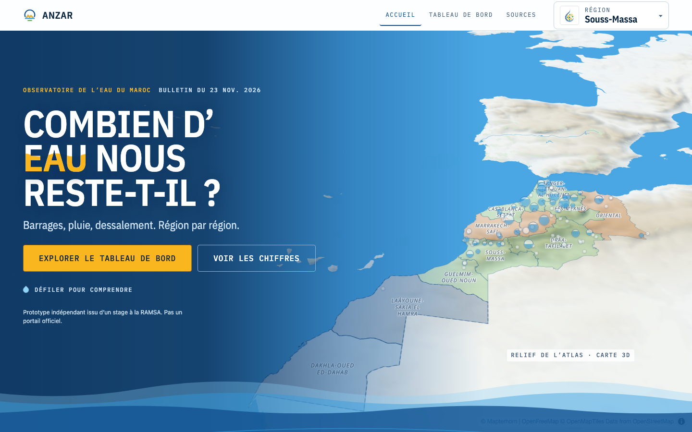
</p>

> **Prototype indépendant, issu d'un stage à la RAMSA. Ce n'est pas un portail officiel.** Les chiffres des barrages sont des instantanés publics datés, lus sur le bulletin du ministère. Ils ne sont pas des relevés en direct.

---

## Le problème

Le Maroc vit d'une eau rare et irrégulière. Au **23 novembre 2026**, les barrages du pays sont remplis à **66,09 %** (11 253 Mm³ sur 17 028 Mm³), contre environ **31 %** le même jour un an plus tôt. Mais cette moyenne cache de grands écarts : de **40 %** dans le bassin Drâa-Oued Noun à **81 %** dans le Tensift. Et le Sud, sans barrage ni lien physique documenté vers le reste du pays, dépend du dessalement.

<p align="center">
  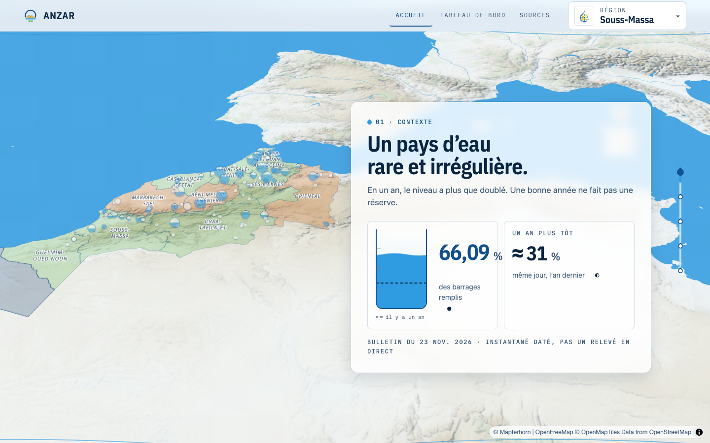
  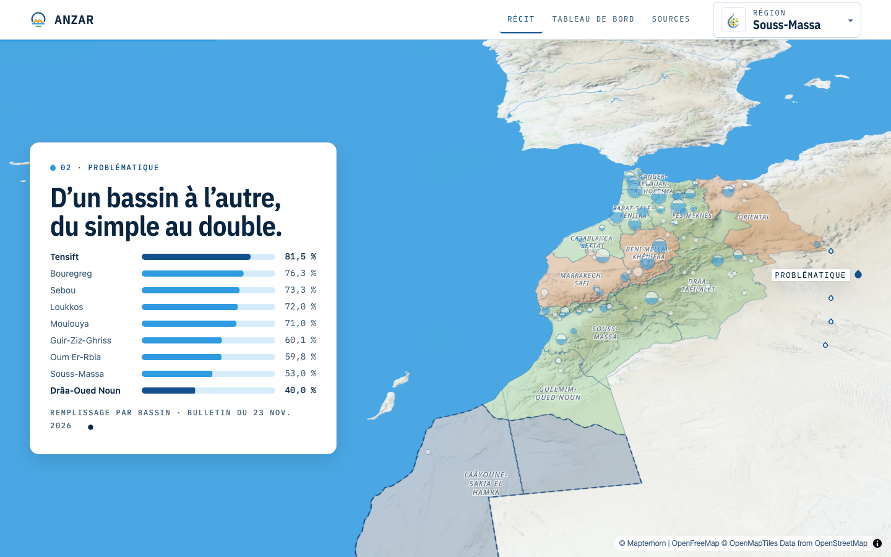
</p>

## Voir où est l'eau

Chaque barrage lu au bulletin est posé sur le relief de l'Atlas, comme un petit réservoir dont le niveau d'eau monte jusqu'à son taux de remplissage. La carte est réellement en 3D (relief Mapterhorn, rivières et retenues en bleu), et elle reste la même du récit d'entrée jusqu'au tableau de bord.

<p align="center">
  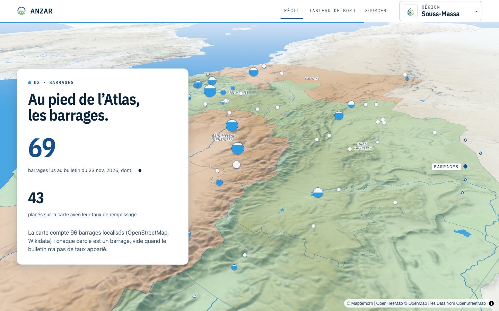
</p>

## Essayer soi-même

La page d'accueil contient déjà un mini-tableau de bord : choisissez une région, économisez 10 % d'eau, ajoutez une station de dessalement, et regardez les **mois de réserve** bouger en direct. C'est le même calcul que celui du tableau de bord complet.

<p align="center">
  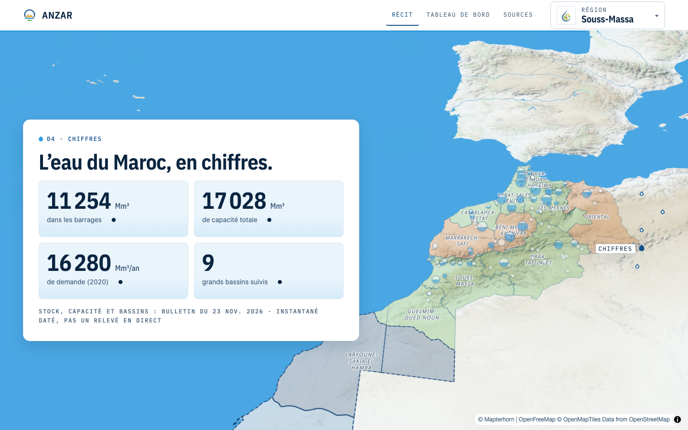
  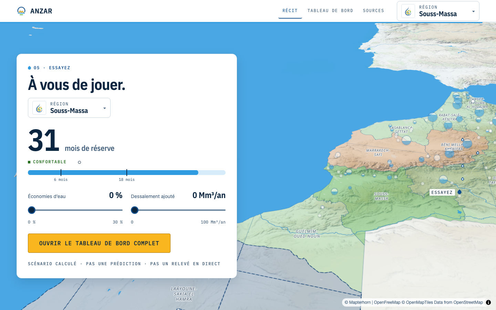
</p>

## Comprendre l'eau

Au-delà des chiffres du jour, Anzar explique pourquoi l'eau manque et ce qui peut changer, avec des visuels simples et des faits **vérifiés à la source primaire**, datés, chacun avec sa pastille de provenance :

- **606 m³ d'eau renouvelable par habitant et par an** (2023), contre 2 560 en 1960 et un seuil de pénurie de 1 000 ;
- des **apports aux barrages** qui passent de 10,3 à 1,95 milliards de m³ entre 2017-18 et 2021-22, contre 11,5 en moyenne depuis 1945 ;
- « un barrage plein n'est pas un robinet ouvert » : envasement, évaporation, et priorité légale à l'eau potable (loi 36-15, article 126) ;
- **les nappes** : environ 5 milliards de m³ pompés pour 4 de renouvelables, soit +28 % (non modélisées dans Anzar, et le site le dit) ;
- les solutions et leurs limites chiffrées : transfert Sebou→Bouregreg, dessalement, réutilisation, rendement des réseaux ;
- des gestes réalistes, avec l'honnêteté de rappeler que l'agriculture pèse près de neuf dixièmes de la demande.

<p align="center">
  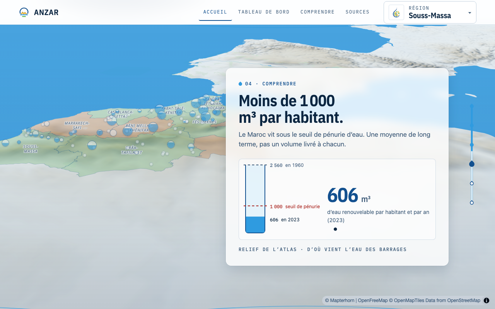
  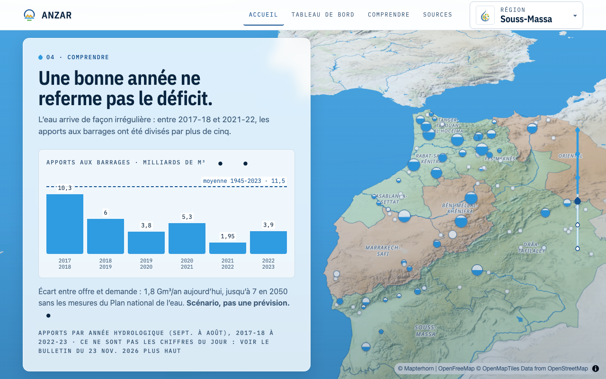
</p>
<p align="center">
  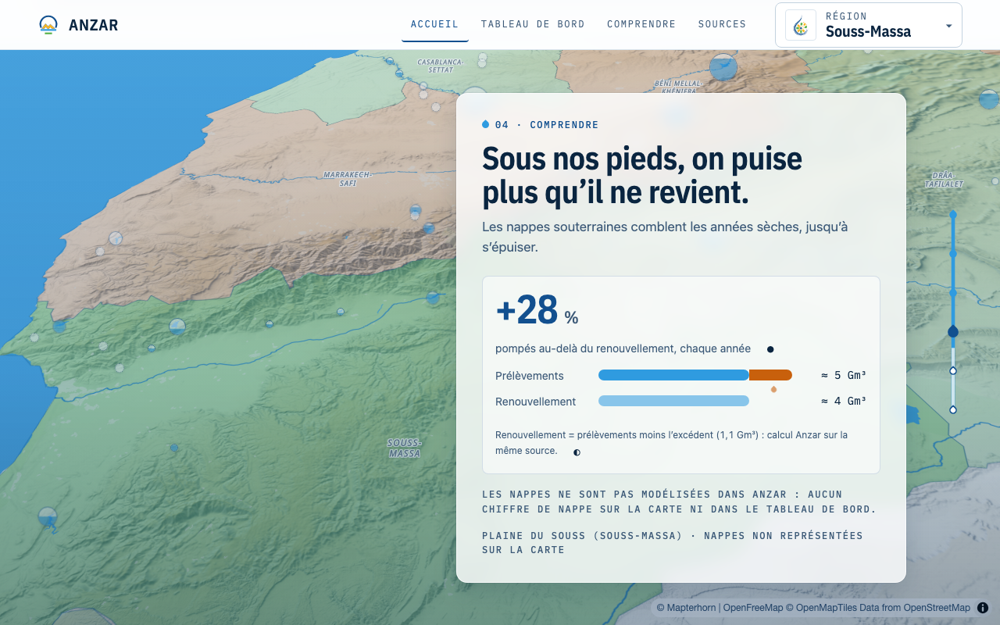
  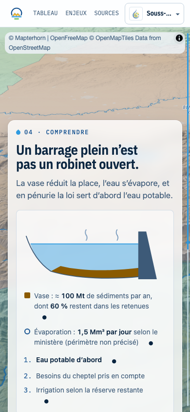
</p>

Ce chapitre s'inspire de la série d'enquêtes de Mustapha Swinga sur la sécheresse au Maroc (épisode « جفاف المغرب : واش فعلاً كين حل ؟ »). La vidéo n'est **pas** une source officielle : ses chiffres ont été retrouvés dans les documents des institutions (ministère de l'Équipement et de l'Eau, IRES, HCP, Banque mondiale, loi 36-15…), et 14 divergences avec la vidéo sont documentées dans [`docs/research/14-video-secheresse.md`](docs/research/14-video-secheresse.md).

## Le tableau de bord

Une carte au centre, un panneau à trois onglets. Choisissez une région en cliquant sur la carte ou dans le sélecteur.

| Onglet | Ce qu'on y voit |
| --- | --- |
| **Aujourd'hui** | La réserve en mois, le stock et la capacité, la demande par usage, la pluie sur 30 jours passés et 7 prévus, l'évaporation, et les barrages du bassin avec leur taux de remplissage |
| **Demain** | Scénarios sec / normal / humide, curseurs (population, économies, dessalement, réutilisation, pluie projetée), courbe sur 10 ans, année d'épuisement du stock, signal climatique CMIP6 |
| **Ensemble** | Les leviers qui comptent, la comparaison des régions, et les liaisons d'eau documentées avec leur source |

<p align="center">
  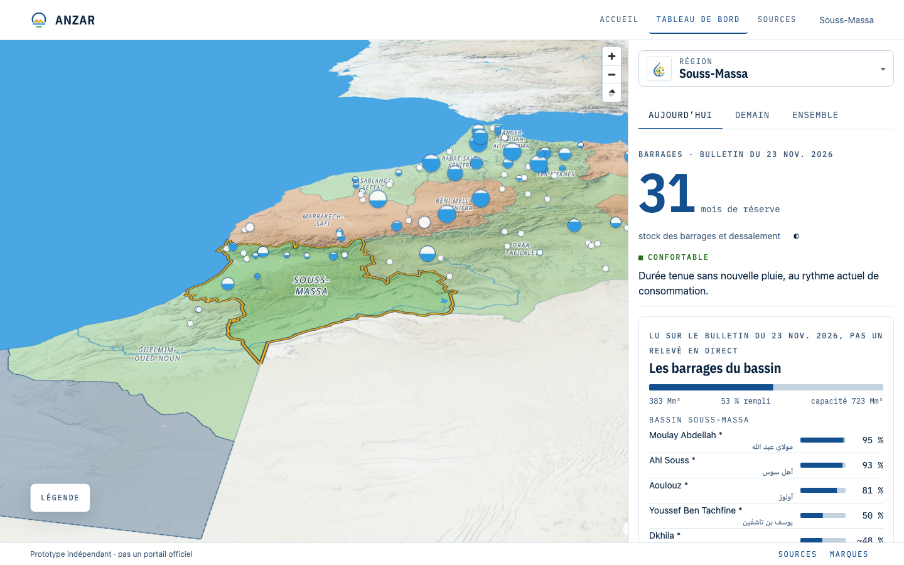
</p>
<p align="center">
  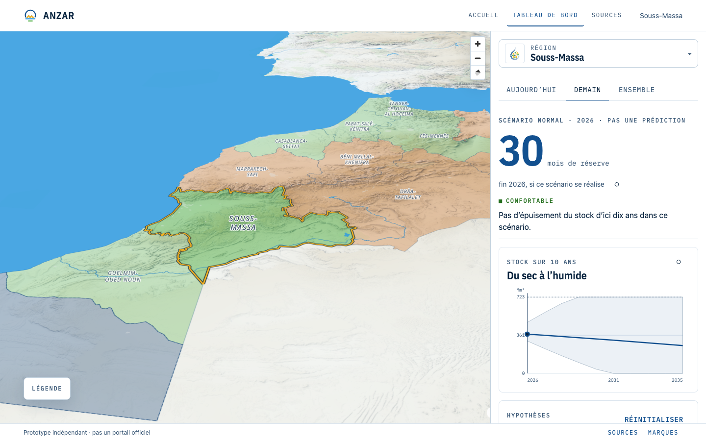
  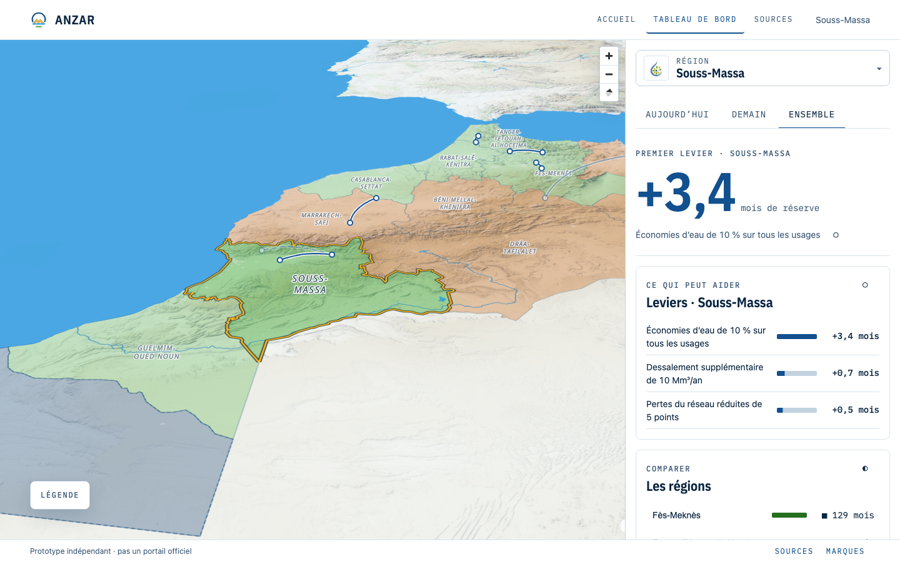
</p>

### Le Sud, dit honnêtement

Aucun transfert physique n'est documenté vers Guelmim-Oued Noun, Laâyoune-Sakia El Hamra ou Dakhla-Oued Ed-Dahab. Anzar le dit au lieu de tracer un tuyau. Pour le Sahara, il n'y a pas de stock de barrage dans le bulletin : la carte affiche un **indicateur de flux** (part de l'eau potable couverte par le dessalement), pas des mois de réserve.

<p align="center">
  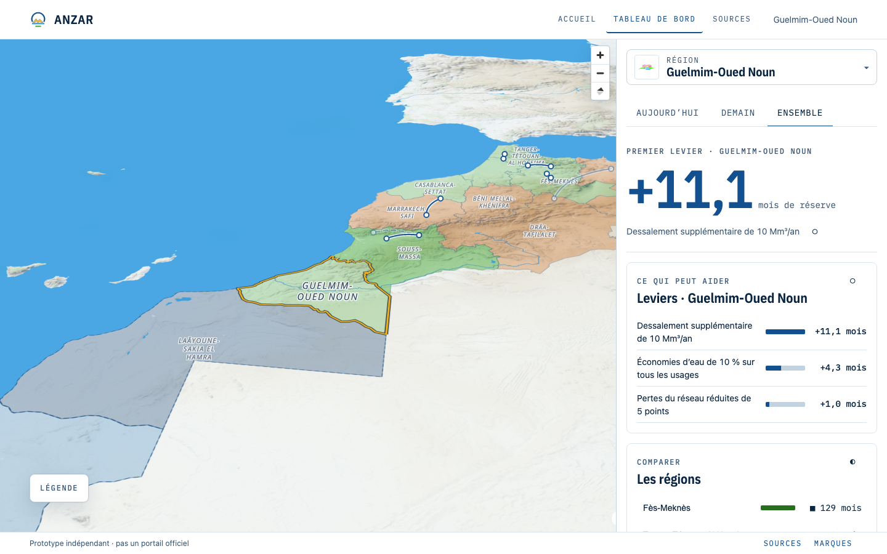
  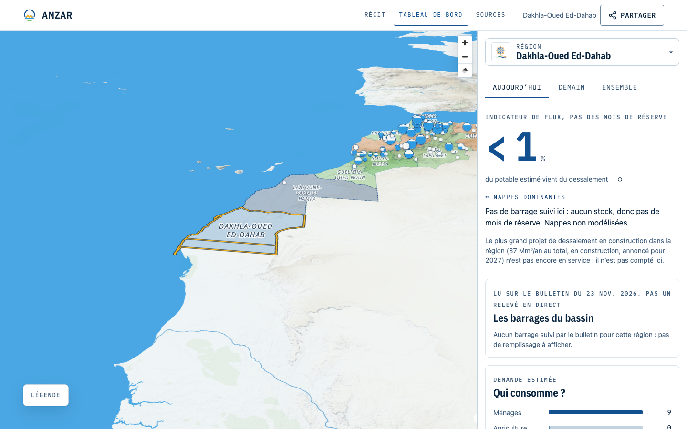
</p>

### Sources et méthode

Chaque chiffre porte son statut : **sourcé**, **dérivé** ou **hypothèse**, avec sa source et sa date. Le tiroir « Sources » liste les données ouvertes utilisées, leurs licences et leur date de récupération.

<p align="center">
  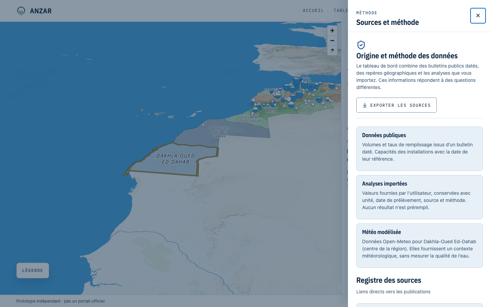
</p>

### Sur téléphone

<p align="center">
  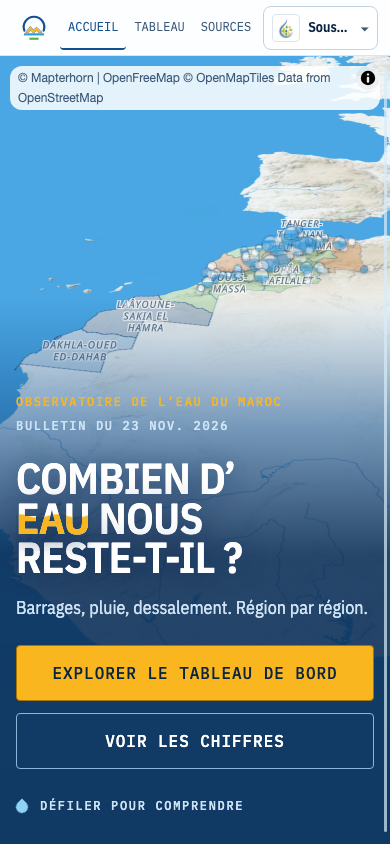
  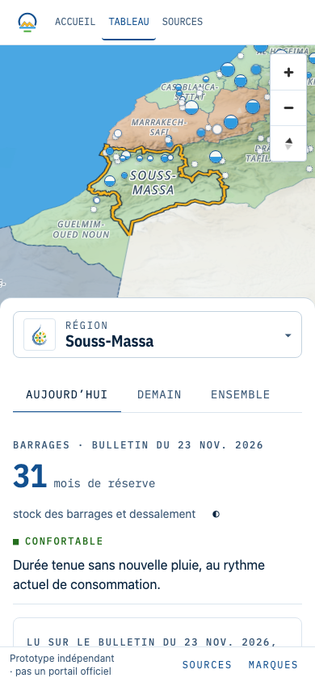
</p>

---

## Ce qui est mesuré, modélisé, estimé

| Nature | Exemples dans Anzar | Comment c'est dit |
| --- | --- | --- |
| **Lu** | Taux de remplissage des barrages (bulletin du ministère du 23 nov. 2026, lu visuellement, sommes par bassin vérifiées) | « Lu sur le bulletin du 23 nov., pas un relevé en direct » |
| **Modélisé** | Pluie, évaporation, débit de rivière (Open-Meteo / GloFAS), projection climatique CMIP6 | « Modélisée », avec licence et date |
| **Dérivé** | Capacité par barrage (stock ÷ taux), part du même jour 2025 | Pastille « dérivé » |
| **Hypothèse** | Consommation par habitant, pertes de réseau, facteurs sec / normal / humide | Pastille « hypothèse », jamais présentée comme un constat |

Anzar ne montre **jamais** : un relevé en direct inventé, un tracé de conduite inventé, un volume « transférable » entre régions, un indice de qualité de l'eau. Les eaux souterraines ne sont pas modélisées (« non modélisé », jamais 0). Un scénario n'est pas une prédiction.

## Les données

| Donnée | Source | Licence |
| --- | --- | --- |
| Remplissage des barrages, 69 barrages | Ministère de l'Équipement et de l'Eau, bulletin quotidien (maadialna.ma) | Accessible publiquement, licence de réutilisation non précisée |
| Barrages localisés (96) | OpenStreetMap, Wikidata, Wikipédia | ODbL, CC0, CC BY-SA |
| Relief | Mapterhorn | Voir attribution sur la carte |
| Fond de carte | OpenFreeMap, OpenMapTiles, OpenStreetMap | ODbL |
| Régions | geoBoundaries, HDX / OCHA | CC BY-IGO |
| Pluie, évaporation, débit, climat | Open-Meteo (ERA5, GloFAS, CMIP6) | Gratuit, usage non commercial |
| Population, demande, dessalement, apports | HCP, ONEE, agences de bassin, presse datée (voir `docs/research/`) | Selon la source |
| Liaisons d'eau (26, dont 7 dessinables) | Presse et documents officiels datés (`data-raw/links/`) | Selon la source |

Le détail, les clés éventuelles et les comptes gratuits à créer sont dans [`docs/OPEN_DATA.md`](docs/OPEN_DATA.md). Aucune clé n'est nécessaire pour ce qu'Anzar affiche aujourd'hui.

## Limites connues

- Le moteur de bilan n'additionne pas encore toute l'irrigation « autre » de Souss-Massa (614 Mm³/an) : la demande agricole y est sous-estimée.
- Les apports récents de Souss-Massa valent environ 0,22 fois la moyenne de long terme : le scénario « normal » est trop optimiste. Les facteurs sec / normal / humide ne sont pas recalés.
- Le lien Sebou→Bouregreg est documenté mais non dessiné : sa prise d'eau n'est localisée dans aucune source lue.
- 98 grands barrages n'ont pas de coordonnée sourcée (Bin el Ouidane compris) ; seuls 42 sont joints à leur remplissage.
- Les logos des SRM appartiennent à leurs titulaires, sans licence de réutilisation.
- Open-Meteo gratuit est limité à un usage non commercial.

## Sous le capot

React 19, Vite 7, MapLibre GL 6 (relief 3D), polices IBM Plex, aucune bibliothèque de graphiques (SVG maison). Un système de design unique (`platform/src/design/`) : aucun code couleur ni police en dur hors des tokens, vérifié par `npm run check:design` (contrastes AA calculés).

```
platform/
  src/hub/          récit d'entrée, carte 3D persistante, panneau à 3 onglets
  src/design/       tokens, kit de composants, couleurs pour la carte
  src/lib/balance.js  moteur de bilan et de scénarios (fonctions pures, testées)
  public/data/      jeux de données (sources, dates, licences dans chaque fichier)
  data-raw/         données brutes datées et notes de recherche
  pipeline/         scripts de collecte
  e2e/              tests Playwright (parcours complets et captures)
docs/               design, contrats de données, recherche
```

### Lancer en local

```bash
cd platform
npm ci
npm run build && npx vite preview   # version de production, recommandée
npm run dev                          # développement (la carte charge lentement en rendu logiciel)
```

### Tester

```bash
npm test                 # tests unitaires et de données
npm run check:design     # couleurs, polices, contrastes AA
npx playwright test e2e/01-landing.spec.js   # parcours navigateur, un fichier à la fois
npm run e2e:shots        # régénère docs/screenshots/
```

### Déployer

Site statique servi par un Worker Cloudflare (assets seuls) sur `anzar.abq.capital` :

```bash
cd platform && sh scripts/deploy.sh
```

L'API Node/SQLite (compte, analyses importées, qualité de l'eau) n'est pas déployée : ces pages annexes affichent « Disponible uniquement dans la version serveur ».

## Pour reprendre le projet

Lire [`HANDOFF.md`](HANDOFF.md), puis [`CLAUDE.md`](CLAUDE.md) et [`docs/README.md`](docs/README.md). Le matériel d'origine du stage (carnet, classeur) est préservé dans `legacy/`.

---

<sub>Anzar est le nom du dieu amazigh de la pluie. Marques : les noms et logos de la SRM-SM et des autres opérateurs sont des marques de leurs titulaires. Licence du code : MIT.</sub>
